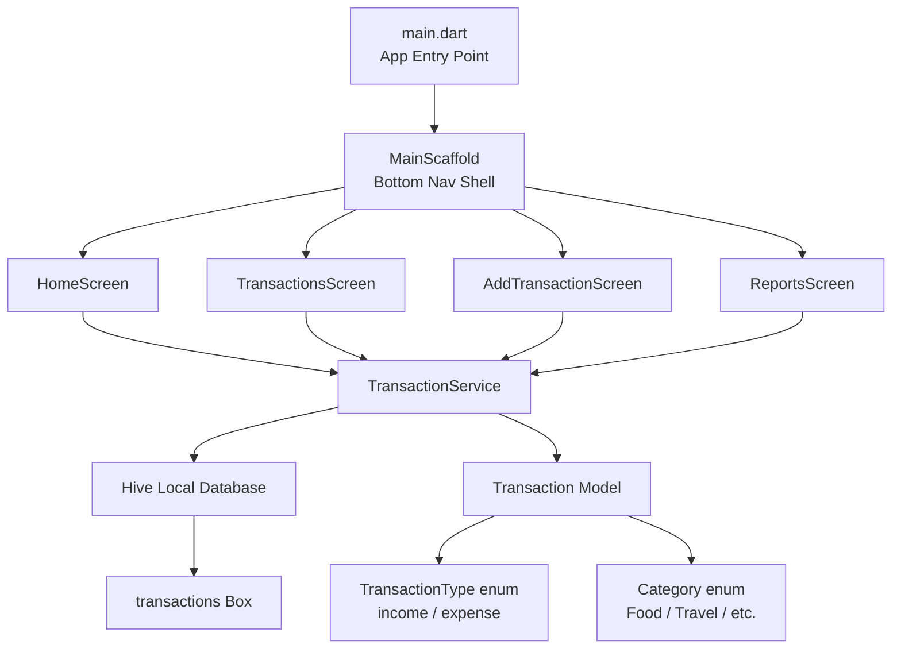
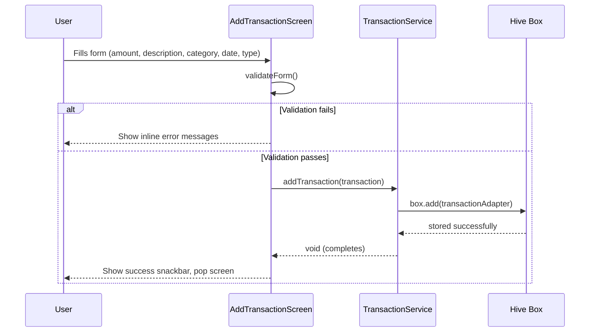
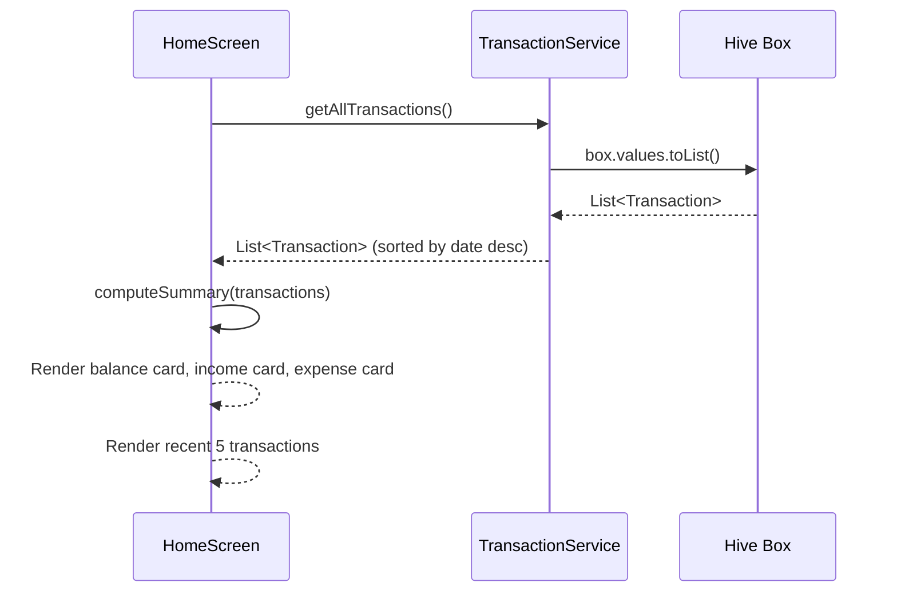
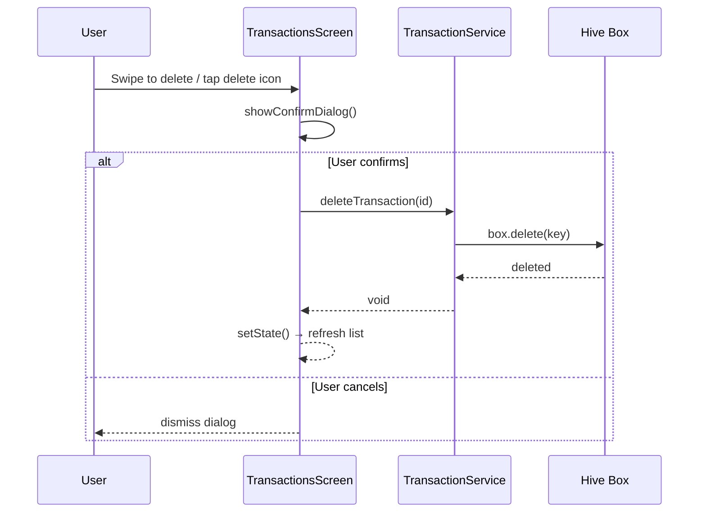
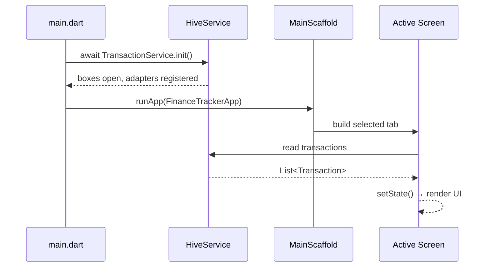

# Design Document: Finance Tracker

## Overview

A clean, beginner-friendly Finance Tracker Android application built with Flutter and Dart. The app allows users to record income and expense transactions, view their current balance, browse transaction history, and see simple spending reports — all stored locally on the device using Hive (a lightweight NoSQL key-value store).

The app follows a feature-first folder structure, uses Material 3 for its design system, and communicates with a local Hive database through a dedicated service layer. There is no authentication, no backend, and no network dependency.

The four main screens — Home (Dashboard), Transactions, Add Transaction, and Reports — are connected via a persistent Bottom Navigation Bar. State is managed using Flutter's built-in `StatefulWidget` and `setState`, keeping the architecture simple and maintainable for beginners.

---

## Architecture



---

## Sequence Diagrams

### Add Transaction Flow



### Load Home Dashboard Flow



### Delete Transaction Flow



---

## Components and Interfaces

### TransactionService

**Purpose**: Single point of access for all CRUD operations on the Hive database. Abstracts Hive internals from the UI layer.

**Interface**:
```dart
abstract class ITransactionService {
  Future<void> init();
  Future<void> addTransaction(Transaction transaction);
  List<Transaction> getAllTransactions();
  Future<void> deleteTransaction(String id);
  double getTotalIncome();
  double getTotalExpenses();
  double getBalance();
  Map<Category, double> getExpensesByCategory();
  List<Transaction> getRecentTransactions({int limit = 5});
}
```

**Responsibilities**:
- Initialize Hive and open the transactions box
- Provide sorted, filtered views of transaction data
- Compute derived values (totals, balance, category breakdowns)
- Abstract storage mechanics from all screens

---

### HomeScreen

**Purpose**: Dashboard presenting the user's financial summary at a glance.

**Interface** (widget parameters):
```dart
class HomeScreen extends StatefulWidget {
  const HomeScreen({super.key});
}
```

**Responsibilities**:
- Display total balance, income, and expenses as summary cards
- Show the 5 most recent transactions using `TransactionListItem`
- Refresh data whenever the screen comes back into focus (using `didChangeDependencies` or a listener)

---

### TransactionsScreen

**Purpose**: Full, scrollable list of all transactions with delete support.

**Interface**:
```dart
class TransactionsScreen extends StatefulWidget {
  const TransactionsScreen({super.key});
}
```

**Responsibilities**:
- Display all transactions sorted by date (newest first)
- Allow deletion via swipe-to-dismiss (`Dismissible` widget) with a confirmation step
- Visually distinguish income (green) from expense (red)

---

### AddTransactionScreen

**Purpose**: Form screen for creating a new income or expense transaction.

**Interface**:
```dart
class AddTransactionScreen extends StatefulWidget {
  const AddTransactionScreen({super.key});
}
```

**Responsibilities**:
- Present type toggle (Income / Expense)
- Validate amount (required, must be a positive number), description (required), category (required), and date (required, defaults to today)
- On valid submit, save via `TransactionService` and show feedback

---

### ReportsScreen

**Purpose**: Summary view showing income vs. expense totals and a breakdown of spending by category.

**Interface**:
```dart
class ReportsScreen extends StatefulWidget {
  const ReportsScreen({super.key});
}
```

**Responsibilities**:
- Display total income and total expenses as summary tiles
- Display a bar chart (using `fl_chart`) showing spending per category
- Show a fallback empty-state message when there are no expense transactions

---

### Reusable Widgets

| Widget | Purpose |
|--------|---------|
| `SummaryCard` | Colored card showing a label, icon, and formatted amount |
| `TransactionListItem` | Single row in a transaction list (icon, category, description, date, signed amount) |
| `CategoryChip` | Selectable chip used in the Add Transaction form |
| `EmptyStateWidget` | Centered illustration + message shown when lists are empty |

---

## Data Models

### Transaction

```dart
@HiveType(typeId: 0)
class Transaction extends HiveObject {
  @HiveField(0)
  final String id;           // UUID v4

  @HiveField(1)
  final double amount;       // Always positive; type determines sign

  @HiveField(2)
  final String description;  // User-supplied note

  @HiveField(3)
  @HiveField(3)
  final TransactionType type; // income | expense

  @HiveField(4)
  final Category category;   // One of 8 predefined categories

  @HiveField(5)
  final DateTime date;       // User-selected date

  @HiveField(6)
  final DateTime createdAt;  // Auto-set at save time

  const Transaction({
    required this.id,
    required this.amount,
    required this.description,
    required this.type,
    required this.category,
    required this.date,
    required this.createdAt,
  });
}
```

**Validation Rules**:
- `amount` must be > 0
- `description` must be non-empty and ≤ 200 characters
- `type` must be a valid `TransactionType` value
- `category` must be a valid `Category` value
- `date` must not be in the future (optional soft constraint)
- `id` is generated using the `uuid` package — never user-supplied

---

### TransactionType (enum)

```dart
@HiveType(typeId: 1)
enum TransactionType {
  @HiveField(0)
  income,

  @HiveField(1)
  expense,
}
```

---

### Category (enum)

```dart
@HiveType(typeId: 2)
enum Category {
  @HiveField(0)
  food,

  @HiveField(1)
  travel,

  @HiveField(2)
  shopping,

  @HiveField(3)
  bills,

  @HiveField(4)
  education,

  @HiveField(5)
  health,

  @HiveField(6)
  salary,

  @HiveField(7)
  other,
}
```

**Display helpers** (defined in a `CategoryExtension`):
- `label` → human-readable string (e.g., `Category.food` → `"Food"`)
- `icon` → `IconData` (e.g., `Icons.restaurant`)
- `color` → `Color` for chip and chart use

---

## Error Handling

### Invalid Form Submission

**Condition**: User taps "Save" with an empty or invalid field.
**Response**: Flutter `Form` + `GlobalKey<FormState>` shows inline validation messages under each `TextFormField`.
**Recovery**: User corrects the field; errors clear automatically on next valid input.

### Hive Initialization Failure

**Condition**: `Hive.initFlutter()` or `Hive.openBox()` throws during app startup.
**Response**: A top-level `try/catch` in `main()` logs the error and shows a full-screen error widget instead of the main app.
**Recovery**: Typically requires re-installing the app (corrupted box); the error message explains this.

### Deletion of Non-Existent Transaction

**Condition**: Race condition or UI bug causes a delete call for an ID that no longer exists in the box.
**Response**: `TransactionService.deleteTransaction` checks for the key's existence before calling `box.delete()`; logs a warning if not found.
**Recovery**: The UI refreshes its list regardless, so stale entries disappear without a crash.

### Empty State — No Transactions

**Condition**: The Hive box is empty (first launch or all deleted).
**Response**: Every list-displaying screen shows an `EmptyStateWidget` with a contextual message.
**Recovery**: User adds a transaction via the Add Transaction screen.

---

## Testing Strategy

### Unit Testing Approach

Test `TransactionService` methods in isolation using an in-memory Hive setup:
- `addTransaction` stores a record correctly
- `getAllTransactions` returns items sorted by date descending
- `deleteTransaction` removes the correct record
- `getTotalIncome`, `getTotalExpenses`, `getBalance` compute correct values
- `getExpensesByCategory` groups and sums correctly

### Property-Based Testing Approach

**Property Test Library**: `test` package with `dart:math` for random generation (or `glados` for property-based testing in Dart).

Key properties to verify:
- `balance == totalIncome - totalExpenses` for any set of transactions
- Adding an income transaction never decreases `getTotalIncome()`
- Adding an expense transaction never decreases `getTotalExpenses()`
- `getRecentTransactions(limit: n)` always returns ≤ n items
- Deleting all transactions results in `getBalance() == 0`

### Widget Testing Approach

- `HomeScreen` renders three summary cards when transactions exist
- `AddTransactionScreen` shows validation errors on empty submit
- `TransactionListItem` displays income in green and expense in red
- `TransactionsScreen` removes a list item after swipe-to-dismiss confirmation

---

## Performance Considerations

- Hive reads are synchronous and in-memory after box open — negligible latency for typical personal finance usage (< 10,000 records).
- Summary computations (`getTotalIncome`, `getExpensesByCategory`) iterate over all transactions; this is acceptable for the target data scale but should be replaced with incremental counters if the user accumulates thousands of records.
- The `fl_chart` bar chart renders at most 8 bars (one per category) — no virtualization needed.
- `TransactionsScreen` uses `ListView.builder` for lazy rendering of the full transaction list.

---

## Security Considerations

- No authentication and no sensitive user identity data is stored.
- All data is local to the device; no network permissions are requested in `AndroidManifest.xml`.
- `amount` values are stored as `double`; currency arithmetic is done with rounding to 2 decimal places to avoid floating-point drift in displayed totals.
- The app does not request any dangerous Android permissions.

---

## Dependencies

| Package | Version | Purpose |
|---------|---------|---------|
| `hive` | `^2.2.3` | Local NoSQL database |
| `hive_flutter` | `^1.1.0` | Flutter integration for Hive |
| `hive_generator` | `^2.0.1` | Code generation for Hive adapters |
| `build_runner` | `^2.4.9` | Runs code generation |
| `uuid` | `^4.4.0` | Generates unique transaction IDs |
| `fl_chart` | `^0.69.0` | Bar chart in Reports screen |
| `intl` | `^0.19.0` | Date and currency formatting |
| `path_provider` | `^2.1.3` | Required by `hive_flutter` on some platforms |

---

---

# Low-Level Design (Code-First)

## Main Algorithm/Workflow



---

## Core Interfaces/Types

```dart
// lib/models/transaction.dart

@HiveType(typeId: 0)
class Transaction extends HiveObject {
  @HiveField(0) final String id;
  @HiveField(1) final double amount;
  @HiveField(2) final String description;
  @HiveField(3) final TransactionType type;
  @HiveField(4) final Category category;
  @HiveField(5) final DateTime date;
  @HiveField(6) final DateTime createdAt;

  Transaction({
    required this.id,
    required this.amount,
    required this.description,
    required this.type,
    required this.category,
    required this.date,
    required this.createdAt,
  });
}

@HiveType(typeId: 1)
enum TransactionType {
  @HiveField(0) income,
  @HiveField(1) expense,
}

@HiveType(typeId: 2)
enum Category {
  @HiveField(0) food,
  @HiveField(1) travel,
  @HiveField(2) shopping,
  @HiveField(3) bills,
  @HiveField(4) education,
  @HiveField(5) health,
  @HiveField(6) salary,
  @HiveField(7) other,
}

// lib/services/transaction_service.dart
abstract class ITransactionService {
  Future<void> init();
  Future<void> addTransaction(Transaction t);
  List<Transaction> getAllTransactions();
  Future<void> deleteTransaction(String id);
  double getTotalIncome();
  double getTotalExpenses();
  double getBalance();
  Map<Category, double> getExpensesByCategory();
  List<Transaction> getRecentTransactions({int limit = 5});
}
```

---

## Key Functions with Formal Specifications

### `TransactionService.addTransaction()`

```dart
Future<void> addTransaction(Transaction transaction) async
```

**Preconditions:**
- `transaction.amount > 0`
- `transaction.description.isNotEmpty`
- `transaction.id` is a valid UUID (non-empty, unique)
- Hive box is open (`_box != null`)

**Postconditions:**
- `getAllTransactions().length == previous.length + 1`
- `getAllTransactions().any((t) => t.id == transaction.id) == true`
- `getTotalIncome()` increases by `transaction.amount` if `type == income`
- `getTotalExpenses()` increases by `transaction.amount` if `type == expense`

**Loop Invariants:** N/A (no loops)

---

### `TransactionService.deleteTransaction()`

```dart
Future<void> deleteTransaction(String id) async
```

**Preconditions:**
- `id.isNotEmpty`
- Hive box is open

**Postconditions:**
- `getAllTransactions().every((t) => t.id != id) == true`
- If id did not exist: list is unchanged, no exception thrown
- `getAllTransactions().length <= previous.length`

**Loop Invariants:** N/A

---

### `TransactionService.getBalance()`

```dart
double getBalance()
```

**Preconditions:**
- Hive box is open (may be empty)

**Postconditions:**
- Returns `getTotalIncome() - getTotalExpenses()`
- Result is a finite `double` (no NaN, no Infinity)
- If no transactions: returns `0.0`

**Invariant**: `getBalance() == getTotalIncome() - getTotalExpenses()` at all times

---

### `TransactionService.getExpensesByCategory()`

```dart
Map<Category, double> getExpensesByCategory()
```

**Preconditions:**
- Hive box is open

**Postconditions:**
- Returned map contains only `Category` keys where at least one expense exists
- For every key `k`: `map[k] == sum of amounts for expenses with category == k`
- All values are positive (`map.values.every((v) => v > 0)`)
- Empty map returned when there are no expense transactions

**Loop Invariants:**
- After processing each transaction in the iteration:
  - All previously processed expense transactions are accounted for in the map

---

### `AddTransactionScreen._validateAndSave()`

```dart
void _validateAndSave()
```

**Preconditions:**
- `_formKey.currentState != null`

**Postconditions:**
- If form invalid: `_formKey.currentState!.validate()` returns false, no transaction saved
- If form valid: `TransactionService.addTransaction()` called exactly once with a new `Transaction` where `id` is freshly generated, `createdAt == DateTime.now()` (within test tolerance)
- On success: navigator pops the screen and a `SnackBar` is displayed

---

## Algorithmic Pseudocode

### App Initialization Algorithm

```dart
// main.dart
Future<void> main() async {
  WidgetsFlutterBinding.ensureInitialized();

  // Step 1: Initialize Hive storage
  await Hive.initFlutter();

  // Step 2: Register type adapters
  Hive.registerAdapter(TransactionAdapter());
  Hive.registerAdapter(TransactionTypeAdapter());
  Hive.registerAdapter(CategoryAdapter());

  // Step 3: Open the transactions box
  await Hive.openBox<Transaction>('transactions');

  // Step 4: Launch app
  runApp(const FinanceTrackerApp());
}
```

**Preconditions:** Flutter binding initialized before Hive calls.
**Postconditions:** App is running with Hive box open and adapters registered.

---

### Transaction Summary Computation Algorithm

```dart
// Called inside HomeScreen.build() / ReportsScreen.build()

// ALGORITHM: computeSummary
// INPUT:  transactions — List<Transaction> (all records from Hive)
// OUTPUT: summary — {balance, totalIncome, totalExpenses}

double totalIncome = 0.0;
double totalExpenses = 0.0;

for (final tx in transactions) {
  // LOOP INVARIANT: totalIncome == sum of income amounts processed so far
  //                totalExpenses == sum of expense amounts processed so far
  if (tx.type == TransactionType.income) {
    totalIncome += tx.amount;
  } else {
    totalExpenses += tx.amount;
  }
}

final double balance = totalIncome - totalExpenses;
// POSTCONDITION: balance == totalIncome - totalExpenses
//               totalIncome >= 0, totalExpenses >= 0
```

---

### Category Breakdown Algorithm

```dart
// ALGORITHM: getExpensesByCategory
// INPUT:  transactions — List<Transaction>
// OUTPUT: breakdown — Map<Category, double>

final Map<Category, double> breakdown = {};

for (final tx in transactions) {
  // LOOP INVARIANT: breakdown contains correct sums for all
  //                expense transactions processed so far
  if (tx.type == TransactionType.expense) {
    breakdown[tx.category] = (breakdown[tx.category] ?? 0.0) + tx.amount;
  }
}

return breakdown;
// POSTCONDITION: for each entry (k, v) in breakdown:
//   v == sum of amounts where type == expense && category == k
//   v > 0 (empty categories are not included)
```

---

### Form Validation Algorithm

```dart
// ALGORITHM: _validateAndSave (AddTransactionScreen)
// INPUT:  form state, _amount, _description, _selectedCategory, _selectedDate, _type
// OUTPUT: side-effect — saves transaction or shows errors

void _validateAndSave() {
  final isValid = _formKey.currentState!.validate();

  if (!isValid) {
    // POSTCONDITION: inline errors shown, nothing saved
    return;
  }

  _formKey.currentState!.save();

  // ASSERT: _amount > 0
  // ASSERT: _description.isNotEmpty
  // ASSERT: _selectedCategory != null
  // ASSERT: _selectedDate != null

  final transaction = Transaction(
    id: const Uuid().v4(),
    amount: double.parse(_amount),
    description: _description.trim(),
    type: _selectedType,
    category: _selectedCategory!,
    date: _selectedDate,
    createdAt: DateTime.now(),
  );

  TransactionService.instance.addTransaction(transaction);

  Navigator.of(context).pop();
  ScaffoldMessenger.of(context).showSnackBar(
    const SnackBar(content: Text('Transaction saved!')),
  );
  // POSTCONDITION: transaction stored in Hive, screen dismissed
}
```

---

## Example Usage

```dart
// Example 1: Adding a transaction
final service = TransactionService.instance;

final tx = Transaction(
  id: const Uuid().v4(),
  amount: 250.00,
  description: 'Monthly grocery run',
  type: TransactionType.expense,
  category: Category.food,
  date: DateTime(2024, 6, 15),
  createdAt: DateTime.now(),
);

await service.addTransaction(tx);

// Example 2: Reading dashboard data
final allTx = service.getAllTransactions();
final balance = service.getBalance();       // e.g. 1500.00
final income  = service.getTotalIncome();   // e.g. 3000.00
final expenses = service.getTotalExpenses(); // e.g. 1500.00

// Example 3: Category breakdown for Reports
final breakdown = service.getExpensesByCategory();
// { Category.food: 250.00, Category.bills: 120.00, ... }

// Example 4: Deleting a transaction
await service.deleteTransaction(tx.id);
// getAllTransactions() no longer contains tx

// Example 5: Recent transactions for Home screen
final recent = service.getRecentTransactions(limit: 5);
// Returns at most 5 items, sorted by date descending
```

---

## Correctness Properties

*A property is a characteristic or behavior that should hold true across all valid executions of a system — essentially, a formal statement about what the system should do. Properties serve as the bridge between human-readable specifications and machine-verifiable correctness guarantees.*

### Property 1: Balance Invariant

*For any* set of income and expense transactions stored in TransactionService, `getBalance()` shall always equal `getTotalIncome() - getTotalExpenses()`.

**Validates: Requirements 9.1, 9.2, 9.3**

```dart
// ∀ state S: S.getBalance() == S.getTotalIncome() - S.getTotalExpenses()
assert(service.getBalance() ==
    service.getTotalIncome() - service.getTotalExpenses());
```

---

### Property 2: Adding a Transaction Persists It

*For any* valid Transaction object, after calling `addTransaction()`, `getAllTransactions()` shall contain exactly one item with the same ID, and the total count shall increase by exactly one.

**Validates: Requirements 4.1, 4.2**

```dart
// ∀ tx valid: getAllTransactions().length == previous.length + 1
//             getAllTransactions().any((t) => t.id == tx.id) == true
```

---

### Property 3: Income Monotonicity

*For any* income transaction added to TransactionService, `getTotalIncome()` after the addition shall be greater than or equal to `getTotalIncome()` before the addition.

**Validates: Requirements 4.3**

```dart
// ∀ tx where tx.type == income:
//   getTotalIncome(after) >= getTotalIncome(before)
final incomeBefore = service.getTotalIncome();
await service.addTransaction(incomeTransaction);
assert(service.getTotalIncome() >= incomeBefore);
```

---

### Property 4: Expense Monotonicity

*For any* expense transaction added to TransactionService, `getTotalExpenses()` after the addition shall be greater than or equal to `getTotalExpenses()` before the addition.

**Validates: Requirements 4.4**

```dart
final expBefore = service.getTotalExpenses();
await service.addTransaction(expenseTransaction);
assert(service.getTotalExpenses() >= expBefore);
```

---

### Property 5: Delete Removes Exactly the Target Transaction

*For any* collection of stored transactions and any transaction ID within that collection, after calling `deleteTransaction(id)`, `getAllTransactions()` shall not contain any transaction with that ID.

**Validates: Requirements 5.2, 5.3**

```dart
// ∀ existingId: getAllTransactions().every((t) => t.id != existingId) == true
final countBefore = service.getAllTransactions().length;
await service.deleteTransaction(existingId);
assert(service.getAllTransactions().length <= countBefore);
assert(service.getAllTransactions().every((t) => t.id != existingId));
```

---

### Property 6: Delete is a No-Op for Non-Existent IDs

*For any* ID that does not correspond to a stored transaction, calling `deleteTransaction(id)` shall not throw an exception and shall leave `getAllTransactions()` unchanged.

**Validates: Requirements 5.4**

---

### Property 7: Category Breakdown Correctness

*For any* set of transactions, `getExpensesByCategory()` shall return a map where every value is positive, only expense categories are present, and the sum of all values equals `getTotalExpenses()` within a tolerance of 0.001.

**Validates: Requirements 8.5, 9.4, 9.5, 9.6, 9.7**

```dart
// ∀ breakdown: breakdown.values.every((v) => v > 0)
//              sum(breakdown.values) ≈ getTotalExpenses()
final breakdown = service.getExpensesByCategory();
final sumOfBreakdown = breakdown.values.fold(0.0, (a, b) => a + b);
const epsilon = 0.001;
assert((sumOfBreakdown - service.getTotalExpenses()).abs() < epsilon);
assert(breakdown.values.every((v) => v > 0));
```

---

### Property 8: Recent Transactions Bound

*For any* positive integer `n` and any collection of stored transactions, `getRecentTransactions(limit: n)` shall return a list of at most `n` items sorted by date descending.

**Validates: Requirements 9.8, 9.9**

```dart
// ∀ limit n: getRecentTransactions(limit: n).length <= n
final recent = service.getRecentTransactions(limit: 5);
assert(recent.length <= 5);
```

---

### Property 9: Form Validation Rejects Invalid Amounts

*For any* amount value that is zero or negative, the AddTransactionScreen form validation shall reject the submission and the transaction count in TransactionService shall remain unchanged.

**Validates: Requirements 3.5, 3.6, 2.2**

---

### Property 10: Form Validation Rejects Invalid Descriptions

*For any* description string that is empty or whose trimmed length exceeds 200 characters, the AddTransactionScreen form validation shall reject the submission and the transaction count in TransactionService shall remain unchanged.

**Validates: Requirements 3.7, 3.8, 2.3**

---

### Property 11: Transaction List Color Coding

*For any* Transaction object rendered as a `TransactionListItem`, the displayed amount color shall be green if the type is `income` and red if the type is `expense`.

**Validates: Requirements 7.2, 7.3**

---

## Project Folder Structure

```
lib/
├── main.dart                    # App entry, Hive init
├── app.dart                     # MaterialApp + theme
├── models/
│   ├── transaction.dart         # Transaction, TransactionType, Category
│   └── transaction.g.dart       # Hive-generated adapters (auto-generated)
├── services/
│   └── transaction_service.dart # All DB operations
├── screens/
│   ├── main_scaffold.dart       # Bottom nav shell
│   ├── home_screen.dart         # Dashboard
│   ├── transactions_screen.dart # Full list + delete
│   ├── add_transaction_screen.dart # Add form
│   └── reports_screen.dart      # Charts + totals
└── widgets/
    ├── summary_card.dart        # Colored stat card
    ├── transaction_list_item.dart # Single transaction row
    ├── category_chip.dart       # Selectable category button
    └── empty_state_widget.dart  # No-data placeholder
```
